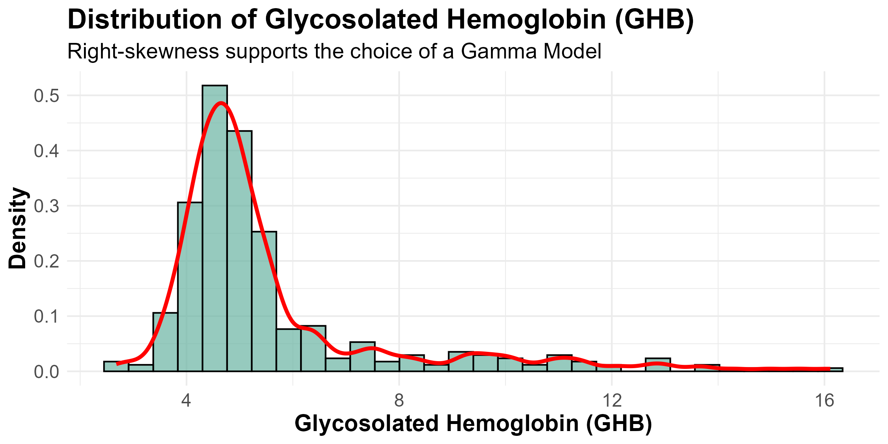
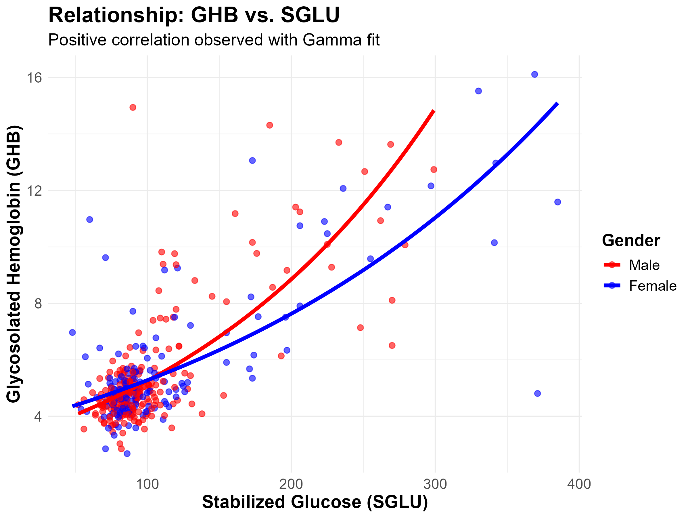
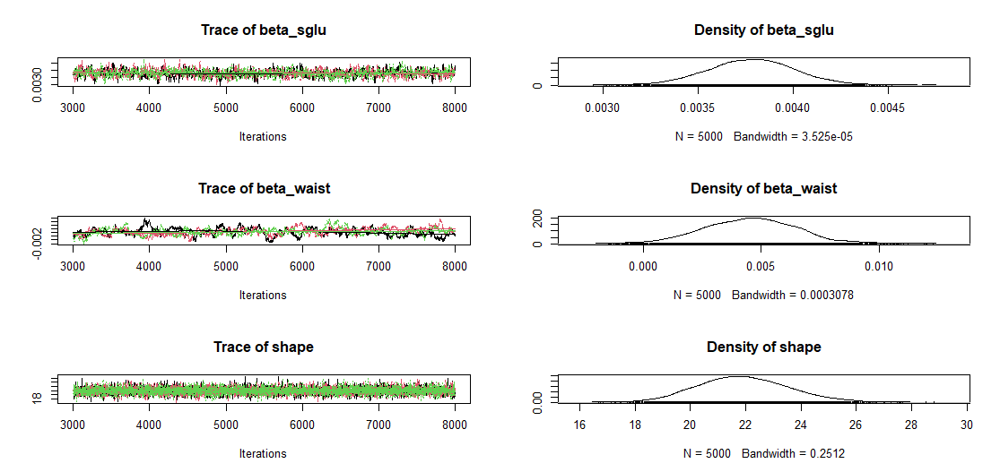

# Bayesian MCMC Regression for Healthcare: Modelling Glycosylated Hemoglobin

Bayesian Generalized Linear Model (Gamma likelihood, log link) fitted with **MCMC in JAGS** to explain **glycosylated hemoglobin (GHB)**, a key diabetes marker, from physiological risk factors. Model selection uses the **Deviance Information Criterion (DIC)** and the results are cross-validated with a **frequentist Gamma GLM + non-parametric bootstrap**.

> Course project for *Computational Statistics*, MSc in Data Science and Engineering, Instituto Superior Técnico (2025/26).

**Skills:** Bayesian inference · MCMC / Gibbs sampling (JAGS) · Generalized Linear Models · model selection (DIC, AIC) · bootstrap resampling · convergence diagnostics · statistical modelling in R · biostatistics / healthcare analytics

<p align="center">
  
  
</p>

## Problem

The data (390 African American subjects from central Virginia; the `diabetes` dataset from Faraway, *Extending the Linear Model with R*) contain GHB together with glucose, cholesterol, age, anthropometric and blood-pressure measurements. GHB is **continuous, strictly positive and right-skewed**, so an OLS/Gaussian model is a poor fit. A Gamma GLM with log link is used instead:

$$y_i \sim \text{Gamma}(r,\ r/\mu_i), \qquad \log \mu_i = \beta_0 + \beta_{SGLU}\,\text{SGLU}_i + \beta_{AGE}\,\text{AGE}_i + \beta_{CHOL}\,\text{CHOL}_i + \beta_{WAIST}\,\text{WAIST}_i + \beta_{SBP}\,\text{SBP}_i$$

with vague priors $\beta_k \sim N(0,\ \tau = 0.001)$ and $r \sim U(0, 100)$.

## Approach

1. **Data cleaning and EDA**: complete-case analysis (367 of 390 subjects), distribution checks, correlation matrix, boxplots by gender and location.
2. **Variable selection**: predictors with correlation $\ge 0.20$ with GHB were kept (SGLU, Age, Cholesterol, Waist, SBP).
3. **Bayesian estimation**: JAGS via `rjags`, 3 chains, 2,000 burn-in iterations + 5,000 samples per chain.
4. **Convergence diagnostics**: Gelman-Rubin $\hat{R}$ and trace/density plots.
5. **Model comparison**: DIC of the reduced (5-predictor) vs. full (14-predictor) model.
6. **Validation**: frequentist Gamma GLM with 1,000 bootstrap replicates (percentile CIs) and AIC.

## Key results

| Model | Mean deviance | $p_D$ | DIC |
|---|---|---|---|
| Full (14 predictors) | 1139 | 15.5 | 1154 |
| **Reduced (5 predictors)** | 1140 | 7.2 | **1147** |

Posterior summaries of the selected model:

| Parameter | Posterior mean | 95% credible interval |
|---|---|---|
| $\beta_{SGLU}$ | 0.0038 | [0.0033, 0.0042] |
| $\beta_{AGE}$ | 0.0033 | [0.0018, 0.0049] |
| $\beta_{CHOL}$ | 0.0008 | [0.0002, 0.0014] |
| $\beta_{WAIST}$ | 0.0046 | [0.0007, 0.0086] |
| $\beta_{SBP}$ | 0.0001 | [-0.0009, 0.0012] |
| $r$ (shape) | 21.92 | [18.89, 25.23] |

- All chains converged ($\hat{R} \le 1.02$).
- **Stabilized glucose is the dominant predictor**: +50 mg/dL in SGLU leads to roughly **+21% in expected GHB**. Age, cholesterol and waist circumference also have credible positive effects.
- **Systolic blood pressure is not significant** once the other factors are accounted for. Both the Bayesian credible interval and the bootstrap CI cross zero.
- The bootstrap GLM estimates (AIC = 1147.1) closely match the posterior means. The frequentist and Bayesian approaches agree.

<p align="center">
  
</p>

## Repository structure

```
.
├── data/
│   └── diabetes.txt                # raw data (no header, tab-separated)
├── figures/                        # plots used in the report
├── report/
│   ├── report.pdf                  # final report
│   └── latex/                      # LaTeX source of the report
└── src/
    └── gamma_regression_analysis.R # full analysis: EDA, JAGS model, DIC, bootstrap
```

## How to run

Requirements: R (≥ 4.2), [JAGS](https://mcmc-jags.sourceforge.io/) installed on the system, and the R packages:

```r
install.packages(c("tidyverse", "patchwork", "rjags", "coda", "boot"))
```

From the repository root:

```bash
Rscript src/gamma_regression_analysis.R
```

Figures are written to `figures/`. MCMC results may differ slightly between runs because of random initialisation.

## Tech stack

R · JAGS / rjags · coda · boot · tidyverse / ggplot2 · LaTeX

## Authors

- **João Pires**
- Gustavo Brazil

## References

- Faraway, J. J. (2016). *Extending the Linear Model with R* (2nd ed.). CRC Press. (source of the dataset)
- Gelman, A. et al. (2013). *Bayesian Data Analysis* (3rd ed.). CRC Press.
- Plummer, M. (2003). JAGS: A program for analysis of Bayesian graphical models using Gibbs sampling.

## License

The code in this repository is released under the [MIT License](LICENSE). Reports and figures are the authors' coursework. The dataset is the publicly available `diabetes` data distributed with Faraway's *Extending the Linear Model with R*.
